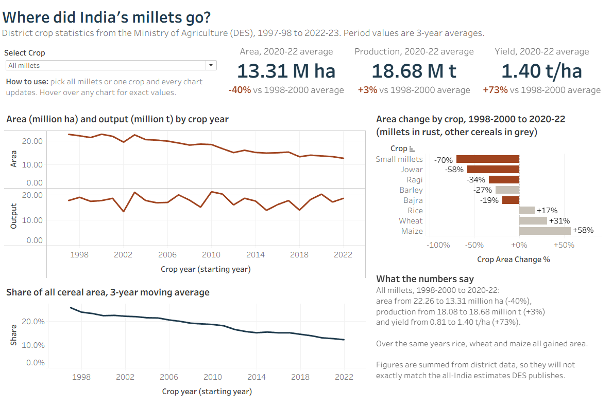

# Where did India's millets go?

2023 was the International Year of Millets, and jowar, bajra and ragi were suddenly everywhere. I wanted to know what had actually happened to millet farming in India before that, so I built a Tableau dashboard from the Ministry of Agriculture's district-level crop statistics, covering 1997-98 to 2022-23 (743 districts, 8 cereal crops).

You can open the live dashboard on [Tableau Public](https://public.tableau.com/app/profile/koushik.maity/viz/india_millets/Overview).

## What I found

To compare periods I used 3-year averages, 1998-99 to 2000-01 against 2020-21 to 2022-23, so that one drought year doesn't decide the result.

Millet area (jowar, bajra, ragi and small millets) fell from 22.3 million hectares to 13.3 million, down 40%. Millets went from 22.5% of all cereal area to 12.2%. But production did not fall with it. Millet output went from 18.1 million tonnes to 18.7 million (+3%), because yield went up from 0.81 to 1.40 tonnes per hectare (+73%). Bajra did most of the work here, its production rose 81% on 19% less land.

Most of the lost area was jowar. Jowar area fell 58%, from 10.1 to 4.2 million hectares, and Maharashtra alone lost about 3 million hectares of it. Over the same years rice area grew 17%, wheat 31% and maize 58%.

When I looked at states, two of them explained most of the decline. Maharashtra and Karnataka together lost about 6 million hectares of millet area, which is 65% of all the area lost. Telangana kept only 13% of its millet area. Rajasthan went the other way: its millet area went up 4% (4.85 to 5.03 million hectares) and it now has 38% of India's millet area, 88% of that bajra. Barmer district alone has 7% of the country's millet area.

## Data and cleaning

The data comes from the [Area, Production & Yield report](https://data.desagri.gov.in/website/crops-apy-report-web) on the Directorate of Economics & Statistics (DES) data portal, Ministry of Agriculture & Farmers Welfare. It gives area, production and yield for every district, year, crop and season. The portal only shows the report on screen or as an Excel export per request, so `fetch_data.py` asks for one state at a time and saves the HTML into `data/raw` (I haven't put the raw files in the repo, the script downloads them again).

The raw report was messier than I expected. It is a pivot table, with crop, season and measure in three header rows and state and district as merged cells, 676,686 cells in all and 365,413 of them blank. State and district names have serial numbers in front (`1. Punjab`, `25. Faizabad`), 102 district names are in odd case like `West tripura`, and years are text like `1997 - 1998` and not in order. One crop can also have up to six seasons, so I added the seasons up to get one row per district, year and crop.

Then there were the actual errors. 628 rows have an area but no production, and I dropped them (about 0.02% of all the area). Small millets in Maharashtra for 2010-11 show 4.53 million hectares, about 60 times the usual figure, so I dropped that too, along with 23 rows where the yield is above 15 tonnes per hectare, which isn't possible for these crops. Dadra and Nagar Haveli and Daman and Diu show up under three names because they were merged in 2020, so I used the merged name everywhere, and I counted Ladakh under Jammu and Kashmir for the same reason. Lakshadweep has no data at all.

After `prepare.py` the clean file, `cereals_clean.csv`, has 77,318 rows. `analysis.py` works out every number above from it, and I checked that the dashboard shows the same numbers.

## The dashboard

The Overview dashboard has the headline numbers, the area and output trend, millets' share of cereal area and the change for each crop, plus a short summary that updates with the crop you pick. The States dashboard has a map of the change in area, the states ranked by area gained or lost, and a district list. Clicking a state on the map or on the bars filters the district list to that state.

The `Select Crop` parameter switches everything between all millets and one millet. The period values are calculated fields like `SUM(IF [Period] = '2020-22' THEN [Sel Area] END) / 3`. For each state's share of India I used a FIXED LOD with no dimension, so the all-India total stays the same whatever state is in the view, and the district share uses `{FIXED [state] : ...}` in the same way. The share of cereal area line is a 3-year moving average done with a table calculation, `WINDOW_AVG([Share of Cereal Area], -2, 0)` computed along the crop year.

## Files

`india_millets.twbx` is the workbook, with the data packaged inside as an extract, so it opens in Tableau Public directly. `cereals_clean.csv` is the cleaned data. `fetch_data.py`, `prepare.py` and `analysis.py` download, clean and analyse it, in that order (`pip install -r requirements.txt` first). The `screenshots` folder has both dashboards, and the Overview with jowar selected.

## Things to keep in mind

The numbers are summed from district data and don't exactly match the all-India estimates DES publishes separately, so I've compared changes and shares rather than treating the totals as official national figures.

Some states stop reporting some crops. Maharashtra has no small millets figures after 2015-16 and Jharkhand none after 1998-99, so part of the 70% fall in small millets is just missing data. The other millets are reported much more consistently.

1997-98 is incomplete (Kerala and Himachal Pradesh are missing, and Chhattisgarh has only 6 districts), which is why my comparison starts at 1998-99, though the year still shows on the trend charts. District boundaries also changed a lot (Telangana went from 9 to 30 districts in 2016-17 and Andhra Pradesh from 13 to 26 in 2022-23), so I compared states over time rather than districts.
